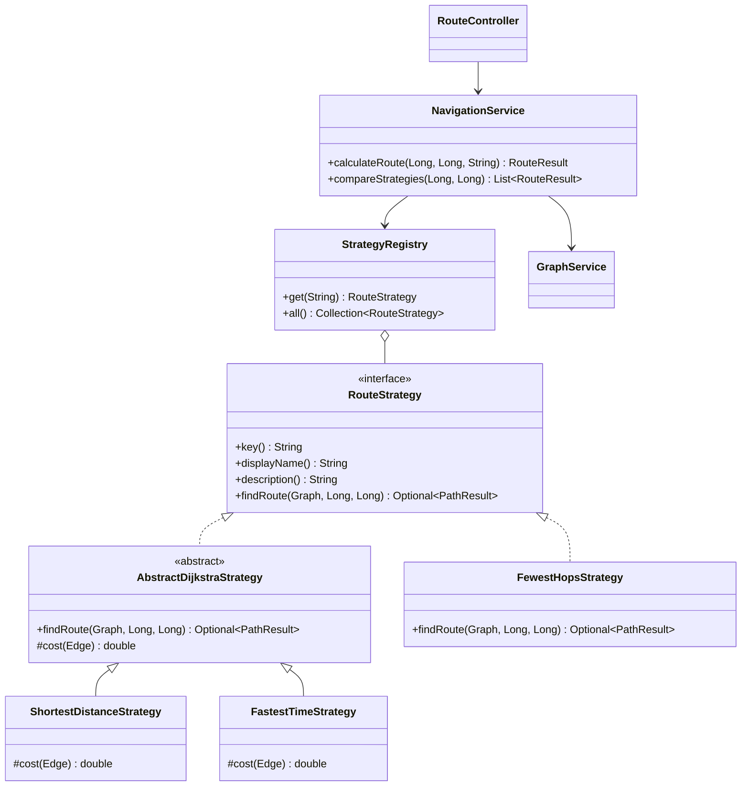

# NavegaSmart

Prototipo web que calcula rutas entre dos puntos de una red usando **estrategias intercambiables** (patrón Strategy). Demuestra que la misma red produce rutas óptimas distintas según el criterio: distancia, tiempo o número de conexiones.

Tecnologías: **Spring Boot 3.5 (Java 17+)**, **PostgreSQL 16**, **React 19 + Vite**.

---

## 1. Cómo ejecutarlo

### Requisitos

- Java 17 o superior y Maven 3.9+ (o abrir `backend/` en IntelliJ / VS Code con Spring Boot Tools).
- Node.js 20.19+ o 22.12+.
- Docker (para la base de datos) o una instalación local de PostgreSQL.

### Paso 1: base de datos

```bash
docker compose up -d
```

Crea la base `navegasmart` (usuario y contraseña `navegasmart`) en el puerto 5432.

Sin Docker, en `psql` como superusuario:

```sql
CREATE USER navegasmart WITH PASSWORD 'navegasmart';
CREATE DATABASE navegasmart OWNER navegasmart;
```

No hay que crear tablas: **Flyway** ejecuta automáticamente `V1__create_schema.sql` (tablas) y `V2__seed_sample_network.sql` (red de ejemplo) al arrancar el backend.

### Paso 2: backend

```bash
cd backend
mvn spring-boot:run
```

Queda en `http://localhost:8080`. La conexión se puede cambiar con las variables `DB_URL`, `DB_USER` y `DB_PASSWORD`.

### Paso 3: frontend

```bash
cd frontend
npm install
npm run dev
```

Abrir `http://localhost:5173`. Vite redirige las llamadas `/api` al backend, así que no hay que configurar nada más.

La aplicación pide iniciar sesión. Al arrancar por primera vez se crea el usuario de demostración **`demo` / `demo1234`**; también se puede crear una cuenta desde la pantalla de acceso.

### Despliegue en AWS

La carpeta `deploy/aws/` publica la aplicación en una instancia EC2 con Docker, detrás de CloudFront (HTTPS):

```
Usuario ──HTTPS──> CloudFront ──HTTP──> EC2 t3.micro (solo acepta tráfico de CloudFront)
                                         ├─ frontend: nginx (React + proxy de /api)
                                         ├─ backend:  Spring Boot
                                         └─ db:       PostgreSQL 16 (volumen Docker, sin puerto público)
```

Requisitos: AWS CLI v2 con credenciales, Docker en ejecución y Python 3. En Windows, usar Git Bash.

```bash
bash deploy/aws/deploy.sh    # primera vez: crea todo (~10 min). Después: publica la versión nueva
bash deploy/aws/destroy.sh   # elimina todos los recursos (y los datos)
```

- `template.yaml` (CloudFormation): rol IAM, grupo de seguridad, EC2 con Amazon Linux 2023, IP elástica y CloudFront.
- `docker-compose.yml`: los tres contenedores de la instancia. Las imágenes se guardan en ECR.
- La contraseña de PostgreSQL y la clave JWT se generan dentro de la instancia (`/opt/navegasmart/.env`).
- No hay SSH: para entrar a la instancia se usa `aws ssm start-session --target <InstanceId>`.
- Costo aproximado fuera del free tier: ~13 USD/mes (EC2 t3.micro, 20 GB de disco, IPv4 pública). CloudFront y ECR quedan prácticamente en cero con este tráfico.
- CloudFront corta las solicitudes a los 60 s: los benchmarks muy grandes deben hacerse en local.

### Pruebas automáticas

```bash
cd backend
mvn test
```

Las pruebas no necesitan PostgreSQL: trabajan sobre una copia en memoria de la red de ejemplo.

---

## 2. Arquitectura por capas

La estructura de paquetes corresponde directamente a las tres capas de la propuesta:

| Capa | Paquete | Contenido |
|---|---|---|
| Presentación | `frontend/` y `com.navegasmart.presentation` | Interfaz React; controladores REST, DTOs y manejo de errores |
| Lógica de negocio | `com.navegasmart.business` | `NavigationService` (contexto), estrategias, modelo del grafo, pruebas de rendimiento |
| Datos | `com.navegasmart.data` + `db/migration` | Entidades JPA, repositorios Spring Data, esquema y datos en PostgreSQL |

Reglas que se respetan en el código:

- La presentación solo habla con la capa de negocio (nunca con los repositorios ni con las entidades JPA).
- Las estrategias trabajan sobre un `Graph` en memoria, independiente de la base de datos y de Spring; por eso se pueden probar sin infraestructura.
- El grafo se carga una vez desde PostgreSQL y queda en caché (`GraphService`). Así el tiempo medido en cada cálculo corresponde solo al algoritmo.

```
navegasmart/
├── docker-compose.yml
├── backend/
│   ├── pom.xml
│   └── src/main/java/com/navegasmart/
│       ├── presentation/
│       │   ├── controller/   RouteController, GraphController, BenchmarkController
│       │   ├── dto/          RouteRequest, RouteResponse, GraphResponse, ...
│       │   └── advice/       GlobalExceptionHandler, ApiError
│       ├── business/
│       │   ├── strategy/     RouteStrategy, AbstractDijkstraStrategy, ShortestDistanceStrategy,
│       │   │                 FastestTimeStrategy, FewestHopsStrategy, StrategyRegistry
│       │   ├── service/      NavigationService, GraphService, BenchmarkService,
│       │   │                 ExecutionLogService, SyntheticGraphGenerator
│       │   ├── model/        Graph, NodeInfo, Edge, Connection, PathResult, RouteResult, ...
│       │   └── exception/
│       ├── data/
│       │   ├── entity/       NodeEntity, ConnectionEntity, ExecutionLogEntity
│       │   └── repository/   NodeRepository, ConnectionRepository, ExecutionLogRepository
│       └── config/           CorsConfig
└── frontend/
    └── src/
        ├── api.js            Cliente de la API
        ├── App.jsx
        └── components/       RouteView, MapView, RouteSummary, CompareTable,
                              BenchmarkView, HistoryView
```

---

### Autenticación

- **Spring Security** protege la API; `SecurityConfig` define qué rutas son públicas.
- Las contraseñas se guardan con hash **BCrypt** en la tabla `users` (migración `V3__create_users.sql`).
- Al iniciar sesión, `TokenService` emite un **JWT** firmado con HS256 (8 horas por defecto). El servidor no guarda sesiones: cada solicitud trae su token.
- Por capas: `AuthController` (presentación) → `AuthService` (negocio: registro y verificación) → `UserRepository` (datos).
- Variables: `JWT_SECRET` (clave de firma, mínimo 32 caracteres; cambiarla fuera de desarrollo), `TOKEN_VALIDITY` (por ejemplo `2h`), `DEMO_USER_ENABLED=false` para no crear el usuario demo.

## 3. Patrones de diseño aplicados

### Strategy (patrón principal)

| Rol del patrón | Clase |
|---|---|
| Strategy (interfaz) | `RouteStrategy` |
| Estrategias concretas | `ShortestDistanceStrategy`, `FastestTimeStrategy`, `FewestHopsStrategy` |
| Contexto | `NavigationService` |
| Cliente | `RouteController` (recibe la clave de la estrategia elegida por el usuario) |

`NavigationService` no sabe cómo calcula cada estrategia: pide la estrategia al registro, la ejecuta, mide el tiempo y registra el resultado. Cambiar de criterio en tiempo de ejecución es solo enviar otra clave (`SHORTEST`, `FASTEST`, `FEWEST_HOPS`).



### Patrones complementarios

- **Template Method**: `AbstractDijkstraStrategy` implementa Dijkstra una sola vez; las subclases solo definen `cost(Edge)` (kilómetros o minutos). Evita duplicar el algoritmo.
- **Registry + Inyección de dependencias**: Spring inyecta en `StrategyRegistry` todas las clases que implementan `RouteStrategy`. No hay `switch` ni `if/else` por estrategia (principio abierto/cerrado).
- **Repository**: `NodeRepository`, `ConnectionRepository`, `ExecutionLogRepository` aíslan el acceso a PostgreSQL.
- **DTO**: los objetos de `presentation.dto` definen el contrato de la API sin exponer el modelo interno.
- **Arquitectura en capas**: descrita en la sección 2.

`FewestHopsStrategy` usa un algoritmo totalmente distinto (búsqueda en anchura, BFS), lo que muestra que Strategy permite intercambiar algoritmos completos y no solo pesos.

### Cómo agregar una estrategia nueva

Solo se crea una clase; no se modifica ningún servicio, controlador ni la interfaz web (la lista de criterios se obtiene de `GET /api/strategies`):

```java
@Component
@Order(4)
public class LowestCostStrategy extends AbstractDijkstraStrategy {
    public String key() { return "LOWEST_COST"; }
    public String displayName() { return "Menor costo"; }
    public String description() { return "Minimiza el costo estimado del viaje."; }

    @Override
    protected double cost(Edge edge) {
        return edge.distanceKm() * 800 + edge.timeMin() * 150; // ejemplo en pesos
    }
}
```

---

## 4. API REST

Todas las rutas exigen la cabecera `Authorization: Bearer <token>`, excepto `login` y `register`.

| Método | Ruta | Descripción |
|---|---|---|
| POST | `/api/auth/login` | Inicia sesión: `{ "username": "demo", "password": "demo1234" }`. Devuelve `{ token, expiresAt, user }` |
| POST | `/api/auth/register` | Crea una cuenta: `{ "fullName": "Ana Pérez", "username": "ana", "password": "..." }` |
| GET | `/api/auth/me` | Usuario dueño del token |
| GET | `/api/graph` | Nodos y conexiones para dibujar el mapa |
| POST | `/api/graph/reload` | Recarga la red desde PostgreSQL |
| GET | `/api/strategies` | Estrategias disponibles |
| POST | `/api/routes` | Calcula una ruta: `{ "originId": 1, "destinationId": 12, "strategy": "FASTEST" }` |
| POST | `/api/routes/compare` | Calcula la ruta con todas las estrategias: `{ "originId": 1, "destinationId": 12 }` |
| POST | `/api/benchmarks` | Prueba de rendimiento: `{ "sizes": [100, 1000, 10000], "repetitions": 10, "warmupRuns": 3 }` |
| GET | `/api/executions?limit=50` | Historial de ejecuciones registradas |

Los errores tienen siempre el formato `{ status, error, message, timestamp }` (400 datos inválidos, 401 sin sesión o credenciales incorrectas, 404 punto inexistente, 409 usuario ya registrado, 422 sin ruta posible).

---

## 5. Red de ejemplo y resultados esperados

La red tiene 12 puntos y 20 conexiones con cuatro tipos de vía: **centro** (corto pero congestionado), **avenida** (más larga pero rápida), **local** y **perimetral**. Incluye una vía de un solo sentido (Biblioteca hacia Centro Comercial).

De **Terminal de Transporte** a **Aeropuerto**:

| Criterio | Recorrido | Distancia | Tiempo | Tramos |
|---|---|---|---|---|
| Ruta más corta | Terminal, Plaza Central, Universidad, Estadio, Aeropuerto | **9,7 km** | 40 min | 4 |
| Ruta más rápida | Terminal, Mercado, Parque Principal, Museo, Zona Industrial, Aeropuerto | 14,6 km | **17 min** | 5 |
| Menos conexiones | Terminal, Hospital, Aeropuerto | 11,9 km | 24 min | **2** |

Es el caso ideal para la demostración del video: la ruta más corta tarda más del doble que la más rápida.

---

## 6. Relación con las pruebas de la propuesta (sección 11)

| Prueba | Cómo se realiza | Evidencia |
|---|---|---|
| Funcional | `RouteStrategiesTest` y pestaña Rutas | Ruta válida o mensaje de error claro |
| Estrategias | Botón "Comparar criterios" y `strategiesProduceDifferentRoutes()` | Tabla comparativa con el mejor valor resaltado |
| Rendimiento | Pestaña Rendimiento (`POST /api/benchmarks`) | Tiempo promedio, mínimo y máximo en ms |
| Escalabilidad | Mismo benchmark con 100 a 50 000 nodos o más | Gráfica tiempo vs. nodos y CSV descargable |

Detalles del benchmark para el informe:

- Cada tamaño genera una red sintética tipo cuadrícula (calles de 15 a 45 km/h y avenidas de 60 a 90 km/h que cruzan varias cuadras), con semilla fija para que todas las estrategias se midan sobre el mismo grafo.
- La ruta va de una esquina a la opuesta, lo que obliga a recorrer gran parte de la red.
- Se hacen ejecuciones de calentamiento antes de medir, porque la JVM optimiza el código (JIT) durante las primeras ejecuciones.
- Complejidad esperada: Dijkstra O((V + E) log V); BFS O(V + E). La gráfica debería mostrar a BFS por debajo de las estrategias basadas en Dijkstra.
- Todo queda registrado en la tabla `execution_logs` y se puede exportar desde la pestaña Historial.

---

## 7. Oportunidades de mejora (para las conclusiones)

- Implementar **A\*** con heurística de distancia euclidiana para reducir los nodos explorados.
- Guardar en caché las rutas ya calculadas para pares origen-destino frecuentes.
- Estrategia combinada con pesos configurables (por ejemplo, 70 % tiempo y 30 % distancia).
- Tiempos por franja horaria para simular tráfico sin depender de servicios externos.
- Editor de la red desde la interfaz (hoy se modifica por SQL y se recarga con `/api/graph/reload`).
